# Ecos da Floresta: A Jornada de Lumo

Jogo de plataforma 2D em pixel art feito na **Unity 6 (6000.0.76f1)** com **C#**, para a disciplina de Game Development.

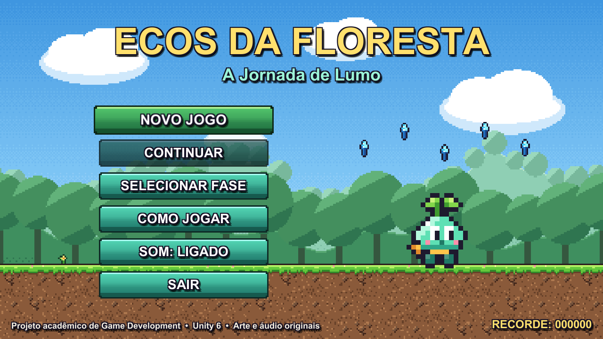

## História

Lumo é um pequeno guardião mágico da Floresta Encantada. A energia da floresta está desaparecendo e criaturas corrompidas começaram a dominar o lugar. Para restaurar o equilíbrio, Lumo precisa atravessar três regiões, recuperar os cristais de energia e devolver o brilho ao **Cristal Primordial**.

## Como jogar

| Ação | Teclado | Gamepad |
|---|---|---|
| Andar | A / D ou ← / → | Analógico esquerdo |
| Correr | Segure SHIFT (ou X) | Botão X |
| Pular (segure para ir mais alto) | ESPAÇO (ou Z) | Botão A |
| Subir/descer escadas | W / S ou ↑ / ↓ | Analógico |
| Descer de plataforma de madeira | ↓ + ESPAÇO | ↓ + A |
| Pausar | ESC ou P | Start |
| Ligar/desligar som | M | — |

**Objetivo:** chegar ao portal no fim de cada fase. Na fase 3, toque no Cristal Primordial.

- Cristal de energia: +100 pontos
- Derrotar inimigo pisando nele: +150 pontos
- Vida restante ao concluir a fase: +250 pontos cada
- Cristal Primordial: +1000 pontos

Você tem **3 vidas por fase**. Tocar em inimigos ou espinhos tira uma vida e dá alguns instantes de invulnerabilidade (o Lumo pisca). Cair num buraco tira uma vida e leva o Lumo de volta ao último **totem de checkpoint**. Sem vidas, aparece a tela de **Fim de Jogo**.

## Fases

| Fase | Dificuldade | Novidades |
|---|---|---|
| 1. Floresta Encantada | Fácil | Andar, pular, plataformas de mão única, primeiro inimigo, correr para vãos longos, espinhos, checkpoint |
| 2. Cavernas Luminosas | Média | Escadas (inclusive suspensas), morcegos, plataforma móvel, fosso de espinhos, teto com espinhos, coração de vida extra |
| 3. Ruínas da Energia | Difícil | Blocos que desmoronam, esferas de espinhos móveis, Espinhento (não pode ser pisado), mais inimigos, Cristal Primordial |

Inimigos:

- **Lodo Sombrio:** patrulha o chão e vira nas bordas. Pode ser pisado.
- **Morcego Sombrio:** voa em vai-e-vem oscilando. Pode ser pisado.
- **Espinhento:** rápido, com espinhos nas costas. Não pode ser pisado, é preciso pular por cima.

Visão geral das fases:

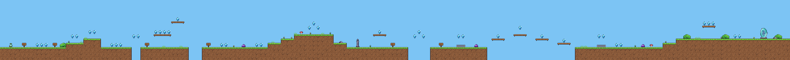
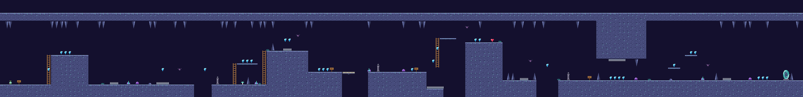
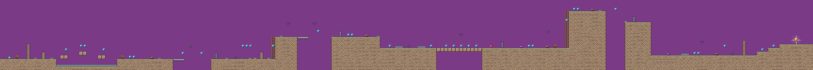

| | |
|---|---|
| 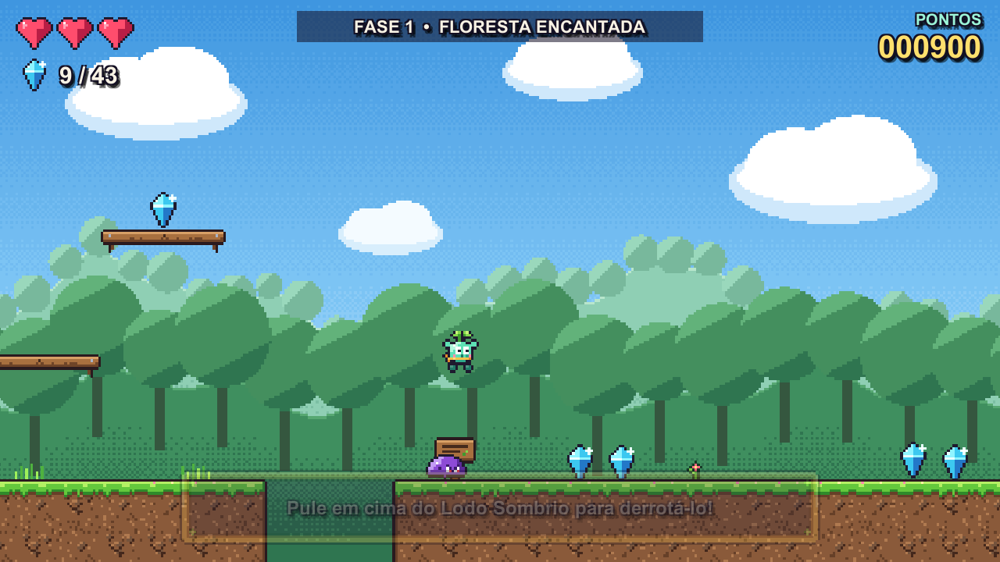 | 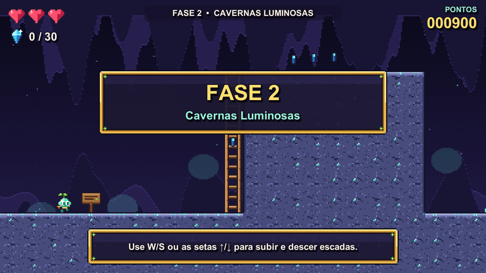 |
| 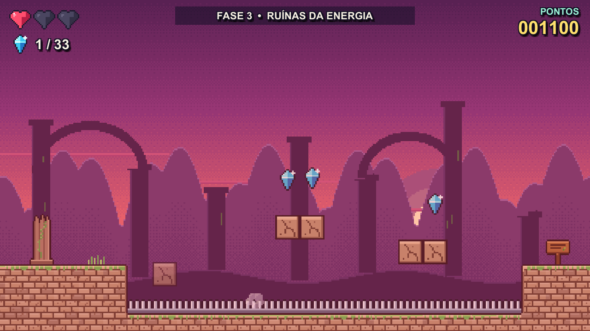 | 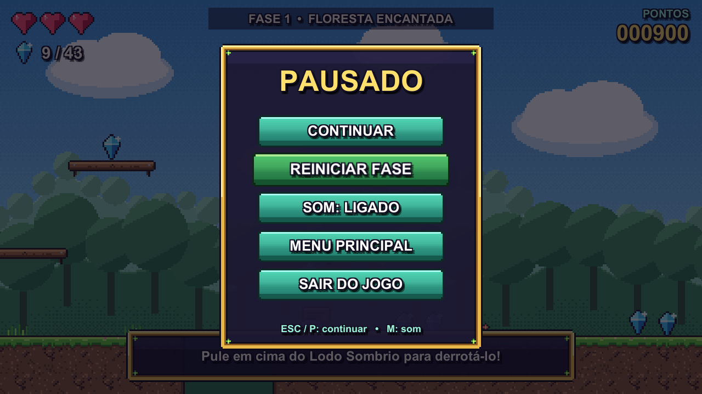 |
| 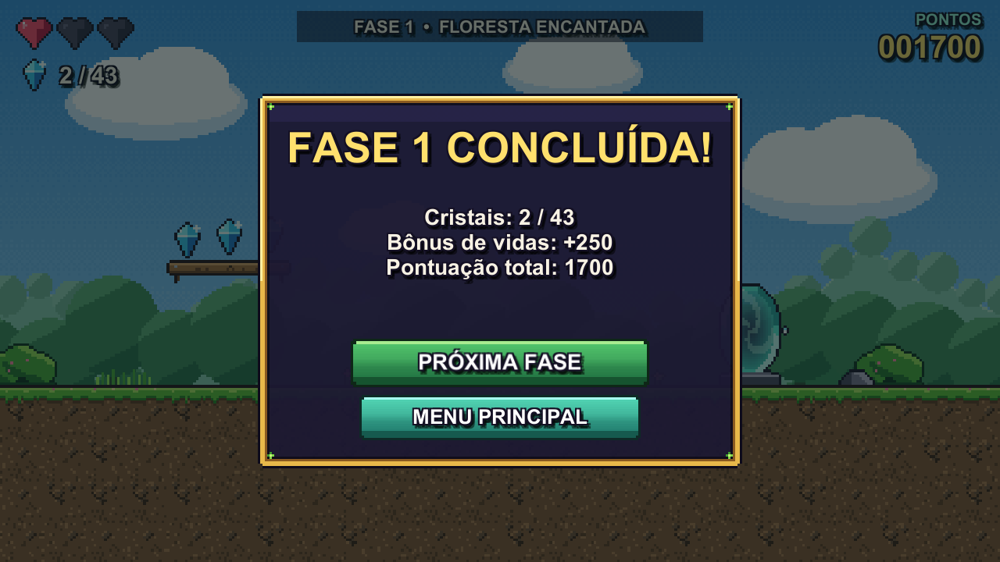 | 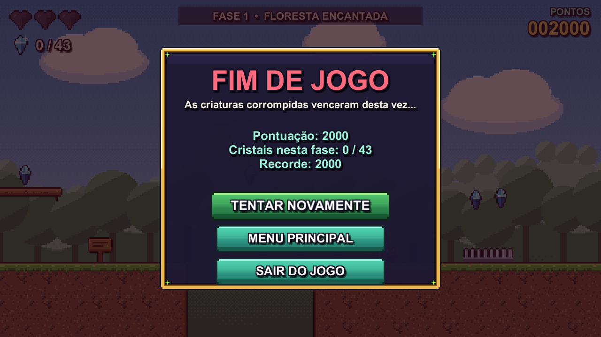 |
| 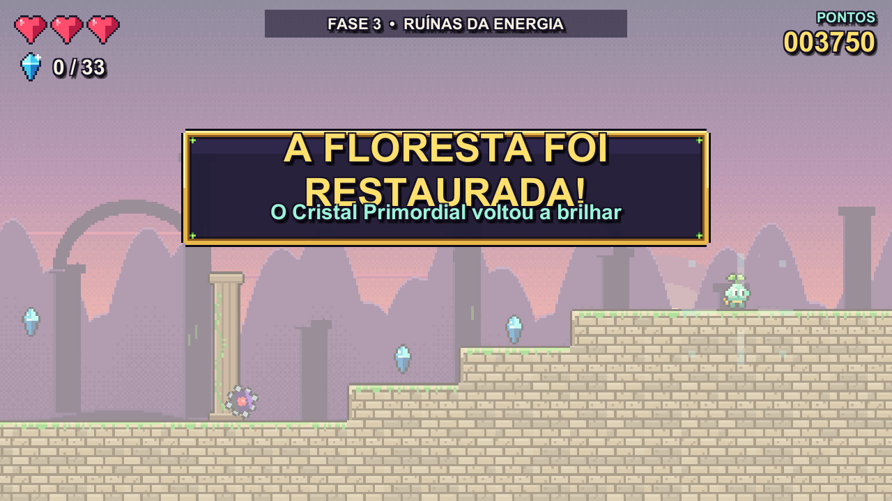 | 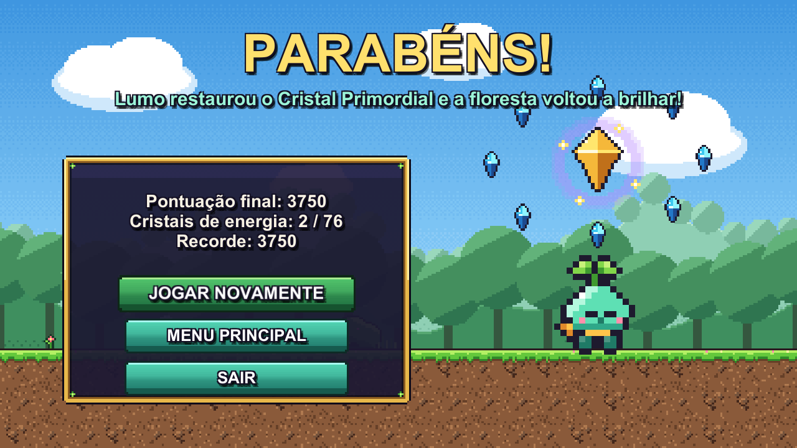 |

## Executar

**Executável (Windows):** abra `Build/Windows/EcosDaFloresta.exe`. A pasta `EcosDaFloresta_Data`, a `MonoBleedingEdge`, a `D3D12` e o `UnityPlayer.dll` precisam estar ao lado do executável. Alt+Enter alterna tela cheia.

**Projeto na Unity:**

1. Instale a Unity **6000.0.76f1** pelo Unity Hub (qualquer Unity 6.0 LTS deve funcionar).
2. No Unity Hub, clique em *Add project from disk* e escolha a pasta do projeto.
3. Abra a cena `Assets/Scenes/MainMenu.unity` e aperte Play.
4. Para gerar o executável: menu **Ecos da Floresta > 2. Gerar executável para Windows** (ou *File > Build Profiles*). O resultado vai para `Build/Windows/`.

## Estrutura do projeto

```
Assets/
  Animations/   Animation Clips e Animator Controllers (Lumo, inimigos, itens, checkpoint, portal, efeitos)
  Audio/        Music/ (5 trilhas) e SFX/ (13 efeitos) em WAV
  Materials/    Material das partículas e material físico sem atrito
  Prefabs/      Player, Enemies, Items, Level, Effects, Managers, UI
  Scenes/       MainMenu, Level1, Level2, Level3, Victory
  Scripts/      Core, Player, Enemies, Level, CameraSystem, UI, Audio, Editor
  Sprites/      Characters, Tiles, Items, Level, Effects, Decor, Backgrounds
  Tilemaps/     Tiles de cada tema (Forest, Cave, Ruins, Shared)
  UI/           Painel, botão, corações, ícone do aplicativo
```

### Scripts principais

| Script | Responsabilidade |
|---|---|
| `Player/PlayerController.cs` | Andar, correr, pular (coyote time, buffer e altura variável), escalar, descer de plataformas, andar sobre plataformas móveis e controlar o Animator |
| `Player/PlayerHealth.cs` | Contato com inimigos (dano ou pisão), perigos e invulnerabilidade com efeito de piscar |
| `Core/GameManager.cs` | Vidas, cristais, pontos, checkpoints, dano, pausa, Fim de Jogo e conclusão da fase |
| `Core/GameSession.cs` e `Core/SaveSystem.cs` | Pontuação entre fases e salvamento (fases liberadas, recorde, som) com PlayerPrefs |
| `Core/SceneLoader.cs` | Troca de cenas com fade |
| `Enemies/PatrolEnemy.cs` e `Enemies/FlyingEnemy.cs` | Patrulha terrestre (paredes e bordas) e voo em vai-e-vem |
| `Level/*` | Coletáveis, checkpoint, portal, espinhos, plataforma móvel, bloco que cai, escada, placas de dica |
| `CameraSystem/CameraFollow.cs` e `ParallaxLayer.cs` | Câmera lateral suave com limites e tremor; fundos com parallax |
| `UI/*` | HUD, painéis da fase, menu principal, vitória |
| `Audio/AudioManager.cs` | Músicas com transição e efeitos sonoros |
| `Core/SelfTestRunner.cs` | Autoteste automático do executável |

### Recursos da Unity usados

Rigidbody2D, colliders 2D (Box, Capsule, Circle, Tilemap e Composite), PlatformEffector2D, Tilemaps, Animator Controller com transições, Animation Clips, Particle System, AudioSource/AudioClip, uGUI (Canvas, CanvasScaler, Button, navegação por teclado), SceneManager, PlayerPrefs, prefabs e camadas de física (Ground, Player, Enemy).

## Arte e áudio

Todo o conteúdo audiovisual é **original**, gerado por código especificamente para este projeto. **Não há assets de terceiros.**

- **Sprites:** desenhados em pixel art por código (`Assets/Scripts/Editor/Generation/Art*.cs`), em 16×16 pixels por tile, 16 pixels por unidade, filtro Point.
- **Músicas e efeitos:** sintetizados em estilo chiptune (`SoundSynth.cs` e `AudioLibrary.cs`), com melodias compostas para o jogo: menu (Fá maior), floresta (Dó maior), cavernas (Lá menor, com eco), ruínas (Ré menor) e vitória.
- **Fonte:** fonte padrão embutida na Unity (`LegacyRuntime.ttf`).

Para trocar algum recurso, substitua o PNG ou WAV na pasta correspondente mantendo o mesmo nome (e, nos sprites, as mesmas dimensões). A Unity reimporta e as referências continuam funcionando.

## Regerar o projeto

O menu **Ecos da Floresta > 1. Gerar projeto completo** recria arte, áudio, tiles, animações, prefabs, as 5 cenas e as Build Settings a partir do código. As fases ficam descritas em `Assets/Scripts/Editor/Generation/LevelDesigns.cs` (por exemplo, `L.Ground(0, 29, 3)`, `L.Slime(55, 3)`). Edite ali e regere para alterar o level design. Um validador avisa sobre cristais ou objetivos fora do alcance do pulo.

Atenção: regerar sobrescreve as cenas. Alterações feitas à mão nas cenas se perdem.

## Testes

O executável tem um autoteste. Rode:

```
EcosDaFloresta.exe -selftest -screenshots Screenshots
```

Ele percorre o menu, as três fases, a pausa e a vitória, simula jogadas e verifica: pisão no inimigo, dano por espinhos, checkpoint, queda em buraco com volta ao checkpoint, coleta de cristal, portal, subida de escada, escada suspensa, plataforma móvel, bloco que desmorona, Fim de Jogo e Cristal Primordial. Resultado da última execução: **14 de 14 verificações ok, 0 erros**. O progresso salvo é restaurado ao final.
